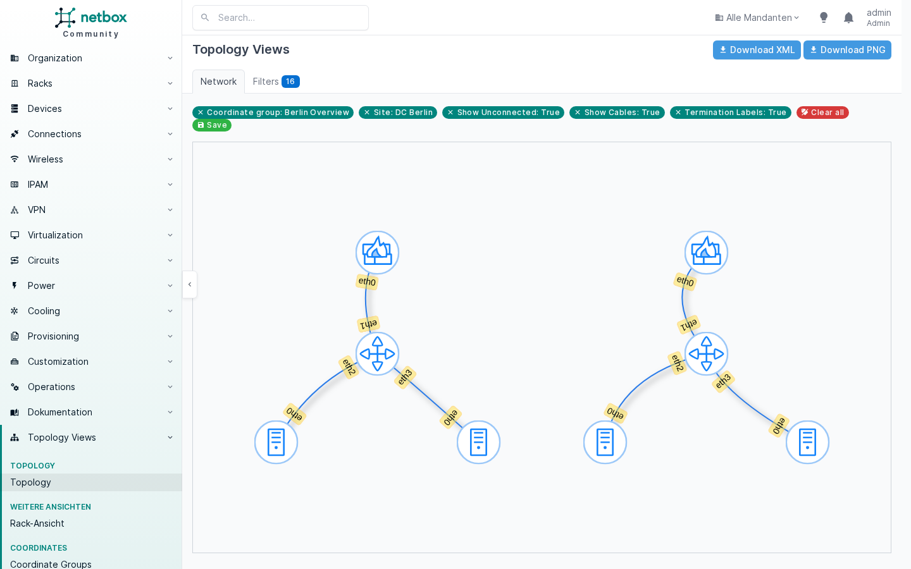
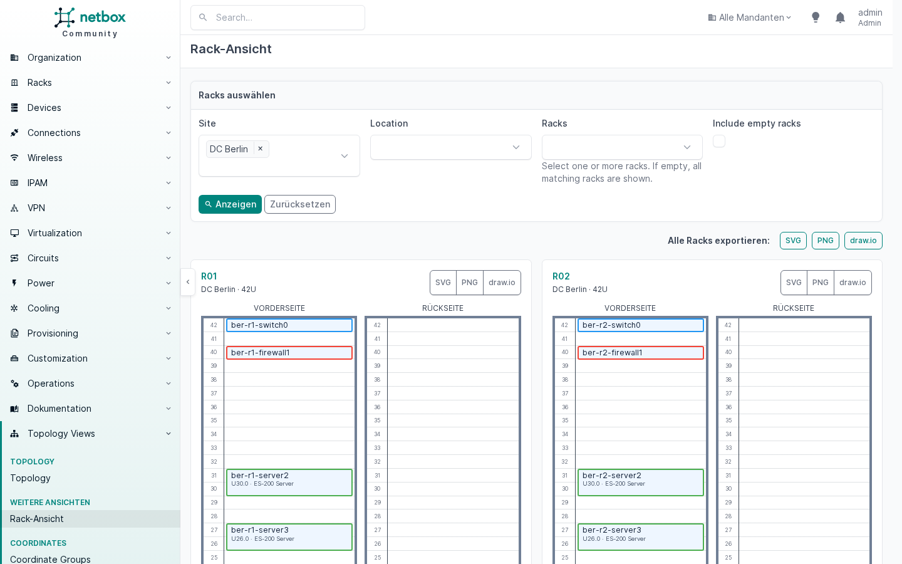

# MRB NetBox Topology Views

A customised fork of **NetBox Topology Views** with extended rack views,
interactive cable tracing and additional network icons.

The plugin builds topologies from the devices, ports and cables maintained in
NetBox. In addition to the classic topology, this fork provides a complete view
of one or more racks including front, rear and cabling.

| | |
|---|---|
| **Plugin name** | `netbox_topology_views` |
| **Package** | `netbox-topology-views` |
| **NetBox** | `4.7.x` |
| **Python** | see `setup.py` |
| **Repository** | <https://git.mrblake.cc/MrBlake/mrb-netbox-topology-views> |

## Screenshots

Cable topology of a site, arranged with a coordinate group:



Rack view with front and rear elevations:



## Features

- Show one or more racks together
- Render devices at their exact rack unit position
- View front and rear of a rack separately
- Ascending/descending U numbering and custom starting unit are respected automatically
- Detect cross-rack and external cable connections
- Freely move devices in the cable topology
- Sort devices in the cable topology by rack position within each rack
- Browser full-screen mode for the cable topology
- Zoom the cable topology between 50 and 200 % and scroll in full-screen
- Render P2P wireless links and multi-access WLANs as purple dashed radio links
- Optionally show/hide wireless links and power cables in the rack view's cable topology, visually distinct from network cables (purple dashed / orange dotted)
- Store manual positions per rack selection in the browser
- Highlight a device's connections in white on hover
- Show all connected ports and peers of a device
- Show a cable's terminations on hover
- Open devices and cables in NetBox directly from the topology
- Export single racks, all racks or the cable topology as SVG, PNG and draw.io — always with transparent background
- Colours of rack view and export follow the active light or dark mode
- Additional icons for network, leaf, spine and aggregation switches

### Changes compared to the original

1. New menu category **More views**.
2. A rack view with filters for site, location and multiple racks.
3. Position-accurate rack elevations for front and rear.
4. A cable table with A and B terminations.
5. An interactive, movable cable topology below the racks.
6. Hover highlighting and port-to-port tracing for devices and cables.
7. Locally stored device positions and a reset function.
8. An extended, scalable SVG icon set for switch roles.
9. Transparent SVG, PNG and draw.io exports for rack and topology views.
10. Adjustments for NetBox 4.6+, including the changed `Rack.units` property.


## Compatibility

- NetBox `4.7.x` (`min_version`/`max_version` in `netbox_topology_views/__init__.py`)
- Based on NetBox Topology Views `4.5.1`

Since the upstream release officially targets NetBox 4.5.x, test updates to
newer NetBox versions in a staging instance first.

## Installation

All paths assume a standard installation under `/opt/netbox`.

### 1. Install the package

```bash
/opt/netbox/venv/bin/pip install --upgrade --force-reinstall \
  "git+https://git.mrblake.cc/MrBlake/mrb-netbox-topology-views.git@develop"
```

For reproducible production installs, replace `develop` with a release tag or a
full commit ID.

### 2. Add the plugin to `local_requirements.txt`

This makes `upgrade.sh` reinstall the plugin automatically on every NetBox upgrade:

```bash
grep -qxF "git+https://git.mrblake.cc/MrBlake/mrb-netbox-topology-views.git@develop" /opt/netbox/local_requirements.txt \
  || echo "git+https://git.mrblake.cc/MrBlake/mrb-netbox-topology-views.git@develop" | sudo tee -a /opt/netbox/local_requirements.txt
```

If the repository is private, the NetBox server needs a read-only deploy token
or an SSH key. Do not store credentials in `local_requirements.txt`.

### 3. Enable the plugin

In `/opt/netbox/netbox/netbox/configuration.py`:

```python
PLUGINS = [
    "netbox_topology_views",
]

PLUGINS_CONFIG = {
    "netbox_topology_views": {
        "static_image_directory": "netbox_topology_views/img",
        "allow_coordinates_saving": True,
        "always_save_coordinates": False,
    },
}
```

If other plugins are already configured, add `netbox_topology_views` to the
existing list and dictionary instead of replacing them.

### 4. Apply migrations, collect static files, restart

```bash
cd /opt/netbox/netbox
/opt/netbox/venv/bin/python manage.py migrate netbox_topology_views
/opt/netbox/venv/bin/python manage.py collectstatic --no-input
sudo systemctl restart netbox netbox-rq
```

After changes to CSS or icons a hard reload in the browser (`Ctrl+F5`) may be
necessary.

## Update

```bash
/opt/netbox/venv/bin/pip install --upgrade --force-reinstall \
  "git+https://git.mrblake.cc/MrBlake/mrb-netbox-topology-views.git@develop"

cd /opt/netbox/netbox
/opt/netbox/venv/bin/python manage.py migrate netbox_topology_views
/opt/netbox/venv/bin/python manage.py collectstatic --no-input
sudo systemctl restart netbox netbox-rq
```

`--force-reinstall` is required because the fork still uses the internal
package version `4.5.2`.

When NetBox itself is upgraded, `upgrade.sh` reinstalls the plugin from
`local_requirements.txt` and runs migrations and `collectstatic`:

```bash
sudo /opt/netbox/upgrade.sh
sudo systemctl restart netbox netbox-rq
```

## Uninstall

1. Remove `"netbox_topology_views"` from `PLUGINS` and `PLUGINS_CONFIG`.
2. Remove the line from `/opt/netbox/local_requirements.txt`.
3. Uninstall the package and restart NetBox:

```bash
/opt/netbox/venv/bin/pip uninstall netbox-topology-views
sudo systemctl restart netbox netbox-rq
```

## Usage

### Classic topology

**Plugins → Topology Views → Topology** provides the original, filterable
topology view. It supports physical cables, logical connections, neighbour
devices, circuit terminations, power feeds, wireless links, coordinate groups,
and PNG and XML export.

### Rack view

**Plugins → Topology Views → More views → Rack view**

Select a single rack or several racks via site, location and rack; empty racks
can be shown optionally. Devices are rendered according to position, height and
rack face. Below the elevations follow:

1. the interactive cable topology, and
2. a table of all involved cables.

In the cable topology, devices can be moved via drag and drop. Hovering a device
highlights its cables and lists all connected ports; hovering a cable shows both
terminations. A click opens the NetBox object.

The export buttons save a single rack, all displayed racks or the cable topology
as SVG, PNG or draw.io, always without background. In the draw.io export, rack
frames, devices and labels remain individually editable, and topology cables are
real edges that follow the devices.

Positions are stored in the browser's `localStorage` and apply only to that
browser and the specific rack/filter selection.

With [Netbox-Utilities](https://git.mrblake.cc/MrBlake/Netbox-Utilities)
installed, partial-width devices are rendered side by side in the rack view.

## Device icons

Icons are assigned by device role slug. This fork additionally ships:

| Device role slug | Icon file |
| --- | --- |
| `network-switch` | `network-switch.svg` |
| `leaf-switch` | `leaf-switch.svg` |
| `spine-switch` | `spine-switch.svg` |
| `aggregation-switch` | `aggregation-switch.svg` |

Custom images can still be assigned on the **Images** page. The default path is
`netbox_topology_views/img` within `STATIC_ROOT`.

## Permissions

Classic topology: `dcim.view_site`, `dcim.view_device`.

Rack view: `dcim.view_rack`, `dcim.view_device`, `dcim.view_cable`.

Saving classic topology coordinates additionally requires the corresponding
permissions on `netbox_topology_views.coordinate`.

## Origin and credits

This project is a fork of the open-source plugin
[NetBox Topology Views](https://github.com/mattieserver/netbox-topology-views).
The original plugin was created by **Mattijs Vanhaverbeke**. Most of the classic
topology view, data models, filters and export functions are based on his work
and the contributions to the original project.

This fork is developed independently and is not officially affiliated with the
original author or the NetBox project.

## License

Like the original, this project is licensed under the
[Apache License 2.0](LICENSE). Existing copyright, license and attribution
notices of the original project are retained.
